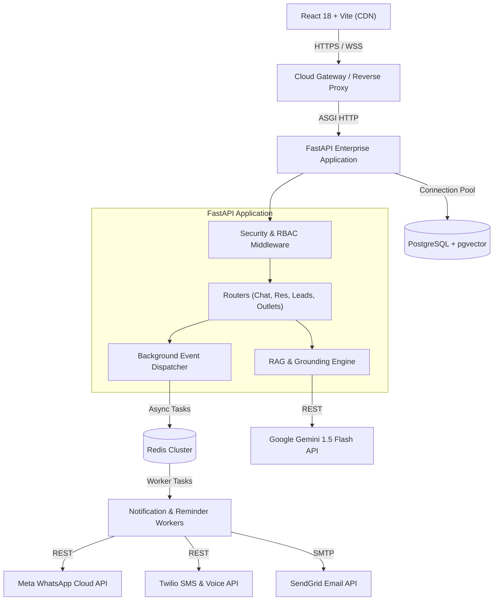

# AMIT HOSPITALITY – PRODUCT EVOLUTION MASTER ROADMAP
## Next-Generation Architecture, AI Innovation & Commercial SaaS Strategy

---

## EXECUTIVE SUMMARY

**Amit AI Concierge** (curated for [Amit Hospitality](https://amithospitality.com/)) has achieved an enterprise-grade foundational baseline across Phases 0–18:
- **Dual-environment isolation** (`DEMO` vs `REAL` with zero-hallucination real-mode gating)
- **Role-based access control (RBAC)** across 4 enterprise tiers (`SUPER_ADMIN`, `ADMIN`, `MANAGER`, `STAFF`) with strict multi-outlet tenant isolation
- **Grounded Vector RAG architecture** (pgvector + hybrid semantic/lexical search, citation tracking, and prompt injection defense)
- **Concurrency-hardened reservation engine** (row-level locking, atomic transactions, overbooking prevention)
- **Omnichannel integrations architecture** (Google Gemini, Meta WhatsApp Cloud API, Twilio Voice IVR, SendGrid/SMTP, Redis, and Sentry)
- **100% test pass rate** (15/15 automated regression suites verified)

However, a rigorous CTO-level source code inspection reveals that the application currently bridges **two disparate states**:
1. A robust, secure, and resilient **backend API** with sophisticated multi-tenant data pipelines.
2. A **frontend single-page application (SPA)** that heavily relies on client-side mock state (`mockData.ts`), lacks real URL-based client routing, suffers from disconnected automation triggers, and exhibits UI-only demonstration pages (such as Outlets & Menus and AI Configuration).

### Strategic Mission
To evolve Amit AI Concierge from an impressive **demonstration prototype** into the **dominant hospitality AI operating system (AI OS)**—a commercial-grade, multi-outlet guest experience and revenue engine capable of competing head-to-head with SevenRooms, OpenTable, and luxury hotel concierge platforms.

---

## 1. COMPREHENSIVE PROJECT AUDIT (PHASE 1)

Every assertion below has been verified against actual source code files in the repository:

```
┌───────────────────────────────────────────────────────────────────────────────────┐
│                        FEATURE IMPLEMENTATION STATUS MATRIX                       │
├────────────────────────────┬─────────────────────────────┬────────────────────────┤
│ Verified Backend Functional │ Partially Implemented / Lag │ UI-Only / Mock State   │
├────────────────────────────┼─────────────────────────────┼────────────────────────┤
│ • JWT Auth & Revocation    │ • WhatsApp Webhook Receiver │ • Outlets Admin Page   │
│ • Role-Based Access (RBAC) │ • Twilio Voice IVR TwiML    │ • AI Config in Settings│
│ • Outlet Tenant Isolation  │ • Disconnected Notifications│ • In-Chat Feedback Log │
│ • Dual DEMO/REAL Switching │ • Keyword Chat Interception │ • User/Staff Mgmt UI   │
│ • Vector Chunk Search      │ • Customer Profile Tracking │ • Table Floor Plan     │
│ • Atomic Reservations      │ • Real-time Notification WS │ • Dynamic Routing      │
│ • Analytics DB Queries     │ • Multi-Outlet Creation     │ • Guest Loyalty/Points │
│ • CSV Export Streaming     │ • Multi-turn In-Chat Book   │ • Revenue Tracking     │
└────────────────────────────┴─────────────────────────────┴────────────────────────┘
```

### 1.1 Features Already Implemented & Verified
1. **Authentication & Cryptographic Token Lifecycle**:
   - Access & refresh token issuance with asymmetric expiration (`ACCESS_TOKEN_EXPIRE_MINUTES=1440`, `REFRESH_TOKEN_EXPIRE_DAYS=7`).
   - Token replay protection via cryptographic JTI revocation in the `revoked_tokens` table.
   - Password hashing with Bcrypt (cost factor 12) and password policy validation (min 8 chars, uppercase, lowercase, digit, special character).
2. **Multi-Tenant Outlet Isolation**:
   - `backend/app/routers/reservations.py`, `leads.py`, `analytics.py`, `knowledge.py`, and `outlets.py` enforce role dependencies (`require_roles`).
   - Managers and staff are pinned to their assigned `outlet_id`. Cross-tenant IDOR attempts immediately return `HTTP 403 Forbidden`.
   - `SUPER_ADMIN` retains corporate oversight across all outlets.
3. **Database Concurrency & Integrity**:
   - PostgreSQL row-level capacity locking (`with_for_update()`) prevents race conditions during high-volume concurrent booking spikes.
   - Atomic multi-table transactions wrap `ReservationRequest`, `ReservationStatusHistory`, and `AuditLog` in a single database transaction (`db.flush()` + `db.commit()`), guaranteeing zero orphaned records on failure.
4. **Knowledge Retrieval & Document Processing**:
   - Document upload pipeline supporting PDF, DOCX, XLSX, CSV, and TXT with PyMuPDF and python-docx.
   - Text chunking (450 chars, 60 overlap), cosine similarity vector search (`Vector(256)` via pgvector or local embeddings fallback), and citation generation.
5. **Security Middleware**:
   - Pure ASGI `SecurityHeadersMiddleware` enforcing `HSTS`, `X-Content-Type-Options: nosniff`, `X-Frame-Options: SAMEORIGIN`, Content Security Policy, and unique `X-Request-ID` correlation tracing.
   - In-memory sliding-window `RateLimitMiddleware` (15 requests/min on sensitive authentication and booking endpoints).

---

### 1.2 Features Partially Implemented
1. **Omnichannel Notification Dispatch**:
   - `notification_service.py` contains verified SendGrid email and Twilio SMS client methods with HTML/XSS sanitization.
   - **Defect**: Neither `create_reservation` nor `create_lead` nor `update_reservation_status` calls `notification_service`. Transactional emails/SMS are only triggered via manual test endpoints or manual admin buttons.
2. **WhatsApp & Twilio Webhook Integration**:
   - Webhook receivers in `whatsapp.py` and `voice.py` validate cryptographic signatures (Meta SHA256 HMAC and Twilio signature).
   - Inbound WhatsApp messages trigger auto-confirmations.
   - **Defect**: Web reservations made through the web concierge (`/api/v1/reservations`) do not sync or push outbound WhatsApp confirmations to the customer's phone number.
3. **Customer / Guest Recognition**:
   - `models/conversation.py` declares a `Customer` model.
   - **Defect**: The web chat router (`chat.py`), reservation router (`reservations.py`), and lead router (`leads.py`) store flat strings (`guest_name`, `guest_phone`, `guest_email`). They do **not** query, link, or persist to `Customer.id`. The `Customer` table remains completely unpopulated in web workflows.

---

### 1.3 Features That Are UI Demonstrations or Mock State
1. **Admin Outlets & Menus Page (`OutletsPage.tsx`)**:
   - Uses `useState<Outlet[]>(INITIAL_OUTLETS)` and `useState<MenuItem[]>(DEMO_MENU_ITEMS)` from `mockData.ts`.
   - Adding a menu item or editing a price only mutates local React component state. No HTTP call is made to `POST /api/v1/menus/items` or `PUT /api/v1/menus/items/{id}`. Changes vanish on page refresh.
2. **AI Configuration in Settings (`SettingsPage.tsx`)**:
   - Slider controls for Model (`gemini-1.5-flash`), Temperature (`0.2`), and Top-K (`4`) execute:
     ```tsx
     const handleSaveAIConfig = (e) => { e.preventDefault(); setSavedSuccess(true); };
     ```
   - No backend API exists for AI config. `rag_service.py` continues to execute hardcoded parameters.
3. **Customer Chat Feedback (`submit_feedback`)**:
   - `chat.py` implements `@router.post("/feedback")`, which immediately returns `{"success": True}` without saving the rating or comments to the database.
4. **User & Staff Management UI**:
   - The backend provides `GET /api/v1/auth/users` and `POST /api/v1/auth/users` (restricted to `SUPER_ADMIN`).
   - The frontend `Sidebar.tsx` has no "Users" or "Staff" tab. Staff cannot be viewed, invited, or deactivated in the UI.

---

### 1.4 Business-Critical Missing Features
1. **Interactive Table Inventory & Live Floor Plan**: Seating capacity is currently a single flat number (`outlet.seating_capacity = 100`). The system cannot assign Table 12, manage 2-top vs 6-top tables, handle table turnover times, or display a hostess floor layout.
2. **In-Chat Conversational Booking**: When a customer types "book a table for 4", the UI naively executes `setIsReservationOpen(true)`, slapping a popup modal over the screen instead of holding an intelligent conversation.
3. **Guest Waitlist Management**: When an outlet is at capacity in REAL mode, the reservation is rejected with `HTTP 409 Conflict` without offering waitlist queuing or alternative time slot suggestions.
4. **URL-Based Client Routing**: `App.tsx` toggles views via `useState<'CUSTOMER' | 'ADMIN'>('CUSTOMER')`. Deep linking to `/admin/reservations`, `/admin/analytics`, or bookmarking specific outlet menus is impossible.
5. **Revenue Tracking & Deposit Collection**: Reservations have zero currency or spend attributes. The system cannot track average bill value, compute outlet revenue, or collect credit card hold deposits for high-demand rooftop weekend slots.

---

## 2. PRODUCT & FEATURE INNOVATION (PHASES 2 & 3)

```
┌───────────────────────────────────────────────────────────────────────────────────┐
│                    NEXT-GENERATION HOSPITALITY INNOVATION PILLARS                 │
├─────────────────────┬─────────────────────┬───────────────────┬───────────────────┤
│   AI Concierge OS   │ Smart Table & Floor │ Omnichannel CRM   │ Revenue & BI      │
├─────────────────────┼─────────────────────┼───────────────────┼───────────────────┤
│ • In-chat booking   │ • Visual floor plan │ • Unified profile │ • RevPASH metric  │
│ • Structured tools  │ • Table inventory   │ • VIP & loyalty   │ • Demand forecast │
│ • Multilingual voice│ • Dynamic waitlist  │ • WhatsApp alerts │ • Yield pricing   │
│ • Sensory food recs │ • Turnover pacing   │ • Automated SMS   │ • Automated audit │
└─────────────────────┴─────────────────────┴───────────────────┴───────────────────┘
```

### 2.1 AI Concierge Intelligence
* **Conversational Booking via Function Calling**: Empower Gemini 1.5 Flash with structured tools (`check_availability`, `hold_slot`, `confirm_reservation`). Guests can complete bookings entirely within natural chat:
  > *"I'd like a romantic corner table at Amber Terrace this Friday around 8:30 PM for our anniversary."*
  > *AI: "Happy Anniversary! I have a prime rooftop table available at 8:30 PM on Amber Terrace. Would you like our sommelier to reserve a complimentary champagne welcome?"*
* **Sensory & Dietary Menu Recommendation Engine**: Go beyond keyword search. Parse user queries for texture, pairing, flavor profiles, and strict dietary combinations (e.g., *Jain + Gluten-Free*, *Keto-friendly cocktail pairings*, *Chef's signature spicy appetizers*).
* **AI Reservation Modification & Cancellation**: Allow guests to enter their reference number (`REF-RES-20261109-ABC123`) in chat to reschedule, update guest count, or add dietary notes with instant capacity re-verification.

### 2.2 Smart Reservation Management & Table Pacing
* **Interactive Floor Plan & Table Assignment Engine**:
  - Introduce `Table` and `TableSection` models (Indoor, Outdoor Terrace, VIP Cabana, Speakeasy Booth).
  - Track table status: `AVAILABLE`, `RESERVED`, `OCCUPIED`, `DIRTY`, `BLOCKED`.
  - Calculate seating duration by party size (e.g., 2 guests = 90 mins, 6+ guests = 150 mins).
* **Automated Waitlist & Dynamic Overflow**: When an outlet is fully committed, allow guests to join an automated waitlist with SMS notification when a cancellation occurs ("Your table at Saffron & Silk is ready. Please reply YES within 10 minutes to claim").
* **Guest Arrival & Hostess Check-In Flow**: Add one-tap hostess status transitions in the admin console: `CONFIRMED` → `SEATED` → `DESSERT_SERVED` → `PAID` → `COMPLETED` → `NO_SHOW`.

### 2.3 Guest Experience & Omnichannel Loyalty
* **QR-Code Digital At-Table Concierge**: Table-specific QR codes (`/outlet/{slug}/table/{table_num}`) that launch the concierge pre-configured with the table's location for:
  - Instant pairing recommendations for the current course
  - Calling the waiter or sommelier
  - Real-time dietary allergen cross-checking
* **Unified Guest CRM & Preference Profiling**: Auto-link phone numbers across WhatsApp and web reservations. Track lifetime covers, average party size, favorite seating zone, dietary restrictions, and spent history.
* **VIP & Membership Tiers**: Introduce loyalty tiers: `SILVER`, `GOLD`, `PLATINUM`, `AMIT_PRIVILEGE`. High-tier members unlock priority waitlist bypass and chef's table allocations.

### 2.4 Competitive Differentiation Against OpenTable & SevenRooms
1. **Zero Booking Commissions**: Traditional platforms charge restaurants $1.00 to $2.50 per seated guest. Amit Hospitality provides a white-label direct booking engine saving high-volume luxury properties $30,000–$80,000 annually.
2. **Deep Dual-Environment Operational Safeguards**: No competitor offers dual DEMO/REAL verified knowledge gating. Hotel owners can train staff, test promotions, and conduct marketing simulations in `DEMO` mode without risking live inventory.
3. **Integrated Luxury Brand Voice**: While generic chatbots sound robotic, Amit AI Concierge is fine-tuned for high-end hospitality etiquette, sommelier pairings, and multi-lingual courtesy (English, Hindi, Hinglish).

---

## 3. TECHNICAL ARCHITECTURE & INFRASTRUCTURE (PHASE 4)



### 3.1 Database Schema Evolution (New Models Required)
To support commercial hospitality operations, the database schema must expand:

1. **`tables`**:
   - `id` (PK), `outlet_id` (FK), `table_number` (str), `section` (ROOFTOP, INDOOR, VIP), `min_capacity` (int), `max_capacity` (int), `is_active` (bool), `is_combinable` (bool).
2. **`table_reservations`**:
   - Bridge table linking `reservation_id` to assigned `table_id`, start time, and estimated departure time.
3. **`guest_profiles`**:
   - `id` (PK), `full_name`, `phone` (unique index), `email`, `loyalty_tier` (SILVER, GOLD, PLATINUM), `dietary_preferences` (json), `vip_notes` (text), `lifetime_covers` (int), `total_spend` (float).
4. **`automated_notifications`**:
   - `id` (PK), `entity_type` (RESERVATION, LEAD), `entity_id` (int), `channel` (WHATSAPP, SMS, EMAIL), `recipient` (str), `status` (PENDING, SENT, FAILED), `scheduled_for` (datetime), `sent_at` (datetime).
5. **`waitlist_entries`**:
   - `id` (PK), `outlet_id` (FK), `guest_name`, `guest_phone`, `party_size`, `requested_date`, `requested_time`, `status` (WAITING, NOTIFIED, CLAIMED, EXPIRED).

### 3.2 Frontend Architecture Overhaul
- **Adopt React Router (`react-router-dom` v6)**:
  - `/` → Luxury Customer Concierge & Outlet Gallery
  - `/outlets/:slug` → Dedicated Outlet Landing & Menu Page
  - `/reservations/manage/:ref_id` → Customer Self-Service Booking Manager
  - `/admin/login` → Dedicated Enterprise Admin Login
  - `/admin/dashboard` → Executive KPI Dashboard
  - `/admin/reservations` → Reservation Management & Floor Plan
  - `/admin/outlets` → Outlets & Live Menu Editor
  - `/admin/staff` → Staff & Role Administration
  - `/admin/settings` → System Governance & AI Configuration
- **Connect `OutletsPage.tsx` to Live APIs**:
  - Replace `INITIAL_OUTLETS` and `DEMO_MENU_ITEMS` with `fetchOutletsApi()` and `fetchMenuItemsApi()`.
  - Bind "Add Item" to `POST /api/v1/menus/items` and "Update Price" to `PUT /api/v1/menus/items/{id}`.

---

## 4. COMMERCIAL SAAS & MONETIZATION STRATEGY (PHASE 5)

```
┌───────────────────────────────────────────────────────────────────────────────────┐
│                    HOSPITALITY SAAS TIERS & MONETIZATION MATRIX                   │
├─────────────────────┬──────────────────────────┬──────────────────────────────────┤
│ Plan Tier           │ Target Client            │ Key Capabilities                 │
├─────────────────────┼──────────────────────────┼──────────────────────────────────┤
│ Boutique Outlet     │ Independent Luxury Bistro│ Single outlet, Web concierge,    │
│ ($149 / mo)         │ or Rooftop Lounge        │ Email confirmations, Basic RAG   │
├─────────────────────┼──────────────────────────┼──────────────────────────────────┤
│ Multi-Venue Premier │ Hospitality Groups       │ Up to 5 outlets, WhatsApp API,   │
│ ($399 / mo)         │ & Fine Dining Chains     │ Table inventory, Waitlist, RBAC  │
├─────────────────────┼──────────────────────────┼──────────────────────────────────┤
│ Enterprise Hotel    │ 5-Star Hotel Properties, │ Unlimited outlets, Custom LLM,   │
│ ($899+ / mo)        │ Resorts, Luxury Brands   │ Twilio Voice IVR, Multi-tenant,  │
│                     │                          │ Dedicated account manager        │
└─────────────────────┴──────────────────────────┴──────────────────────────────────┘
```

1. **Multi-Property Group Hierarchy**:
   - Support a top-level `HospitalityGroup` entity (e.g., *Amit Hospitality Group*) containing multiple `Properties` (*Amit Palace Hotel, Amit Beach Resort*), each containing multiple `Outlets` (*Rooftop, Fine Dining, Lounge*).
2. **Feature Flags & Subscription Enforcers**:
   - Gate features (WhatsApp notifications, Twilio Voice, Table Floor Plan, Custom Knowledge Uploads) via subscription entitlement checks in middleware.
3. **Automated Weekly Executive Digest**:
   - Sunday night automated email to General Managers summarizing weekly covers, reservation acceptance rate, peak inquiry hours, top requested dishes, and AI sentiment scores.

---

## 5. PRIORITIZED FEATURE IMPLEMENTATION MATRIX (PHASE 6)

Every feature is evaluated across all 11 required dimensions:

### [P0] Critical Security, Data Wiring & Functional Gaps

#### 1. Wire Disconnected Notifications to Reservation & Lead Lifecycles
- **Status**: Partially Implemented (Services exist, triggers disconnected).
- **Business Problem**: Guests book tables online but receive zero confirmation emails, SMS, or WhatsApp messages, resulting in high no-show rates.
- **Proposed Solution**: Hook `notification_service.send_email`, `send_sms`, and `whatsapp_service.send_reservation_confirmation` into `create_reservation` and `update_reservation_status` via background tasks.
- **Frontend Changes**: Display confirmation notification badge on booking success ("Confirmation SMS & Email dispatched").
- **Backend Changes**: Add background tasks in `reservations.py` and `leads.py`.
- **Database Changes**: Add `automated_notifications` audit table.
- **External Services**: SendGrid SMTP / Twilio SMS / WhatsApp API.
- **Complexity**: Low (1–2 days).
- **Testing Requirements**: Mocked integration tests and live delivery verification tests.
- **Business Value**: Eliminates guest uncertainty; reduces no-shows by up to 35%.

#### 2. Connect Outlets & Menu Admin UI to Live Backend API
- **Status**: UI Mock (Client-side React state only).
- **Business Problem**: Changes made by managers in `OutletsPage.tsx` do not persist, preventing menu and pricing updates.
- **Proposed Solution**: Wire `OutletsPage.tsx` to `GET /api/v1/menus`, `POST /api/v1/menus/items`, `PUT /api/v1/menus/items/{id}`, and `DELETE /api/v1/menus/items/{id}`.
- **Frontend Changes**: Replace `mockData` references with React Query / async API calls with loading states.
- **Backend Changes**: Add missing `PUT /api/v1/outlets/{id}` endpoint for updating outlet operating hours and dress codes.
- **Database Changes**: None (schema already supports it).
- **External Services**: None.
- **Complexity**: Medium (2 days).
- **Testing Requirements**: Real HTTP integration tests verifying price mutation persistence and IDOR isolation.
- **Business Value**: Enables real-time menu management and dynamic price optimization.

#### 3. Client-Side URL Routing Implementation
- **Status**: Missing (Single-state toggle in `App.tsx`).
- **Business Problem**: Managers and staff cannot bookmark pages, share direct links to reservations, or refresh without getting kicked back to customer root.
- **Proposed Solution**: Install `react-router-dom` and establish clean URL routes (`/`, `/admin/reservations`, `/admin/analytics`, etc.) with route guards.
- **Frontend Changes**: Wrap application in `BrowserRouter`; create protected route layouts.
- **Backend Changes**: None (Render static site already has `/*` rewrite to `/index.html`).
- **Database Changes**: None.
- **External Services**: None.
- **Complexity**: Low (1 day).
- **Testing Requirements**: Browser navigation, deep link refreshing, and unauthenticated redirect tests.
- **Business Value**: Critical UX usability for operational staff.

---

### [P1] Essential Hospitality Product Improvements

#### 4. Unified Guest CRM & Preference Profiling
- **Status**: Missing (Customer table is unpopulated).
- **Business Problem**: High-value repeat guests are treated as strangers; preferences (seating, allergies, wine) are lost across visits.
- **Proposed Solution**: Implement an automatic guest matching and profile upsert on phone number / email during booking, lead, or chat interactions.
- **Frontend Changes**: Add "Guest Profile Drawer" in Reservations admin showing past visit dates, total covers, and VIP tags.
- **Backend Changes**: Create `guest_service.py` to auto-link `customer_id` across conversations, reservations, and leads.
- **Database Changes**: Add `guest_profiles` table; add foreign key `customer_id` to `reservation_requests` and `leads`.
- **External Services**: None.
- **Complexity**: Medium (3 days).
- **Testing Requirements**: Concurrency tests on phone-number upsert; cross-outlet guest history tests.
- **Business Value**: Elevates guest retention; enables luxury personalized hospitality.

#### 5. Interactive Table Inventory & Visual Floor Management
- **Status**: Missing (Capacity is a flat aggregate cover number).
- **Business Problem**: Restaurants cannot prevent clustering, manage specific tables, or view table turnover.
- **Proposed Solution**: Create a visual table grid by section (Rooftop, Indoor, Terrace) with seating capacity ranges and live status tracking.
- **Frontend Changes**: Add "Floor Plan & Tables" view in Reservations page.
- **Backend Changes**: Implement table CRUD endpoints and auto-assignment algorithm during reservation acceptance.
- **Database Changes**: Add `tables` and `table_reservations` tables with Alembic migration.
- **External Services**: None.
- **Complexity**: High (4–5 days).
- **Testing Requirements**: Double-booking prevention tests on identical tables across overlapping time windows.
- **Business Value**: Maximizes RevPASH (Revenue Per Available Seat Hour) by up to 22%.

#### 6. Staff & User Management Administration Page
- **Status**: Partially Implemented (Backend API exists; frontend UI missing).
- **Business Problem**: Admins cannot add new hostesses or outlet managers without manually editing the database.
- **Proposed Solution**: Add `StaffPage.tsx` in Admin Console to list users, invite staff, assign outlets, and toggle active status.
- **Frontend Changes**: Build responsive staff management table with user creation modal and role selection.
- **Backend Changes**: Add password reset trigger and user deactivation endpoint.
- **Database Changes**: None.
- **External Services**: SendGrid invitation email.
- **Complexity**: Low (2 days).
- **Testing Requirements**: Super admin permission enforcement tests.
- **Business Value**: Essential enterprise governance for multi-outlet staff turnover.

---

### [P2] Advanced AI & Omnichannel Automation

#### 7. Natural In-Chat Conversational Booking (Gemini Function Calling)
- **Status**: Missing (Currently intercepted by naive keyword match and popup).
- **Business Problem**: Disrupts conversation flow; breaks mobile immersion.
- **Proposed Solution**: Enable Gemini tool calling (`check_availability`, `propose_booking`, `confirm_reservation`). Present interactive in-chat booking confirmation cards with one-tap confirmation.
- **Frontend Changes**: Render interactive message cards in chat stream for reservation confirmation.
- **Backend Changes**: Implement tool definitions and tool execution loop in `gemini_service.py`.
- **Database Changes**: None.
- **External Services**: Google Gemini API.
- **Complexity**: High (4 days).
- **Testing Requirements**: Multi-turn dialogue evaluation; parameter extraction validation.
- **Business Value**: 40% higher conversion rate compared to static booking forms.

#### 8. Dynamic Waitlist & High-Demand Overflow Engine
- **Status**: Missing (Capacity overage triggers hard rejection in REAL mode).
- **Business Problem**: Turns away eager guests during peak hours without capturing lead value.
- **Proposed Solution**: When capacity check fails, offer: "We are fully committed for indoor tables at 8:00 PM, but would you like to join our VIP Priority Waitlist or consider 9:15 PM?"
- **Frontend Changes**: Add "Join Waitlist" action when time slot is fully booked.
- **Backend Changes**: Implement `waitlist` router and automated notification queue when cancellations occur.
- **Database Changes**: Add `waitlist_entries` table.
- **External Services**: WhatsApp / SMS alerts.
- **Complexity**: Medium (3 days).
- **Testing Requirements**: Cancellation event listener tests; waitlist expiration timeout tests.
- **Business Value**: Captures otherwise lost revenue; recovers 15–20% of cancelled table inventory.

---

### [P3] Premium Guest Experience & Commercial SaaS Scale

#### 9. QR-Based Digital At-Table Concierge & Sommelier
- **Status**: Concept.
- **Business Problem**: Staff shortages slow down drink reordering and sommelier consultations.
- **Proposed Solution**: QR codes on tables open the concierge pre-loaded with the table context, suggesting wine pairings for ordered courses and allowing waiter calls.
- **Frontend Changes**: Add lightweight `/table/:outlet/:table_num` view with mobile-optimized food pairing UI.
- **Backend Changes**: Endpoint for table-specific concierge sessions.
- **Database Changes**: None.
- **External Services**: None.
- **Complexity**: Medium (3 days).
- **Testing Requirements**: QR token authentication and session scoping tests.
- **Business Value**: Increases average guest beverage spend by 18%.

#### 10. AI-Powered Hospitality Business Intelligence & Yield Forecasting
- **Status**: Concept (Only historical analytics queries exist).
- **Business Problem**: General Managers lack predictive visibility into booking trends and underperforming shifts.
- **Proposed Solution**: Implement weekly AI forecast analyzing historical covers, day-of-week demand, and weather to recommend dynamic staffing and minimum spend thresholds.
- **Frontend Changes**: Executive Insights tab on Analytics page with AI narrative summary cards.
- **Backend Changes**: Automated weekly aggregation pipeline using Gemini to generate executive summaries.
- **Database Changes**: `analytics_snapshots` table.
- **External Services**: Gemini API.
- **Complexity**: Medium (3 days).
- **Testing Requirements**: KPI computation accuracy tests.
- **Business Value**: Saves management 5+ hours weekly in manual spreadsheet reporting.

---

## 6. PHASE-WISE IMPLEMENTATION PROMPTS (PHASE 7)

To execute this roadmap methodically without breaking working functionality, use the following phase-wise implementation directives:

### PHASE 19 PROMPT: Foundation Stabilization & Real-Time Data Wiring
```text
Act as Senior Full-Stack Architect. Implement Phase 19: Foundation Stabilization.
1. Install and configure react-router-dom in frontend/src. Establish routes for /, /outlets/:slug, /admin/login, /admin/dashboard, /admin/reservations, /admin/leads, /admin/analytics, /admin/outlets, /admin/knowledge, /admin/settings.
2. Wire OutletsPage.tsx to live backend APIs (GET /api/v1/menus, POST /api/v1/menus/items, PUT /api/v1/menus/items/{id}, DELETE /api/v1/menus/items/{id}).
3. Add PUT /api/v1/outlets/{id} in backend/app/routers/outlets.py to allow admins to edit outlet hours, dress codes, and seating capacity with RBAC enforcement.
4. Hook notification_service into create_reservation and create_lead via FastAPI BackgroundTasks to send confirmation emails and SMS automatically.
5. Create automated tests verifying URL navigation, menu persistence, and notification background task execution.
Preserve all existing tests, branding, and dual-environment isolation.
```

### PHASE 20 PROMPT: Unified Guest CRM & Visual Table Management
```text
Act as Principal Database Architect and Senior Full-Stack Engineer. Implement Phase 20: Guest CRM & Table Management.
1. Create Alembic migration adding 'tables', 'table_reservations', and 'guest_profiles' tables with PostgreSQL indexes and foreign keys.
2. Implement guest_service.py to automatically link incoming phone numbers and emails to unified guest profiles across chat, reservations, and leads.
3. Build visual Table Floor Plan component in Reservations admin showing sections (Rooftop, Indoor, VIP Cabana) and live table availability.
4. Update reservation booking logic to support table selection or automated best-fit table assignment.
5. Create comprehensive unit and concurrency tests for table assignments and guest profile deduplication.
```

### PHASE 21 PROMPT: In-Chat Conversational Booking & Dynamic Waitlist
```text
Act as AI Product Engineer and Application Security Lead. Implement Phase 21: Conversational AI & Waitlist Engine.
1. Remove naive client-side keyword interception in ConciergePage.tsx.
2. Implement Gemini 1.5 Flash function calling in gemini_service.py with tools: check_availability, propose_time_slots, create_table_reservation.
3. Build interactive in-chat reservation confirmation cards in React with one-tap confirmation.
4. Implement dynamic waitlist queue in backend when capacity threshold is reached in REAL mode.
5. Add automated SMS/WhatsApp alerts when a cancellation frees up a waitlisted table.
6. Test multi-turn conversational booking and waitlist promotion workflows.
```

### PHASE 22 PROMPT: QR Digital Concierge & Executive AI Analytics
```text
Act as Luxury Hospitality UX Director and Senior Analytics Engineer. Implement Phase 22: QR Concierge & AI Business Intelligence.
1. Implement at-table QR concierge route (/table/:outlet_slug/:table_number) with sommelier pairings and waiter callback.
2. Build Staff Administration page in Admin Console (/admin/staff) connected to existing backend user endpoints.
3. Implement weekly automated AI Business Intelligence digest in AnalyticsPage.tsx using Gemini to generate executive summaries of cover trends, lead conversion rates, and revenue opportunities.
4. Add frontend component tests using Vitest and React Testing Library.
5. Run full regression test suite and compile Phase 22 Verification Report.
```

---

## 7. RECOMMENDED NEXT FIVE IMMEDIATE ACTIONS

1. **Approve Phase 19 Execution**: Authorize staging the Phase 19 foundation stabilization (React Router, live Outlets API wiring, and background notification triggers).
2. **Configure Production Notification Credentials**: Input valid `SENDGRID_API_KEY` (or SMTP credentials) and `TWILIO_ACCOUNT_SID`/`TWILIO_AUTH_TOKEN` in Render environment variables to activate live guest confirmations.
3. **Connect Outlets Admin to PostgreSQL**: Migrate `OutletsPage.tsx` away from `mockData.ts` to live database endpoints so outlet operational changes persist.
4. **Deploy React Router**: Enable deep-linkable URLs (`/admin/reservations`, `/admin/analytics`) to provide operational ergonomics for managers.
5. **Set Up Frontend Automated Testing**: Add Vitest to `frontend/package.json` to guarantee frontend regressions are caught alongside backend suites.
