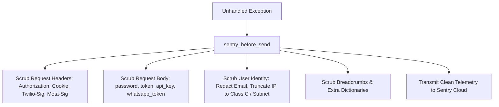

# Sentry Application Observability & PII Security Guide
## Amit AI Concierge — Amit Hospitality (https://amithospitality.com/)

---

### 1. Overview
The Sentry integration provides production-grade Application Performance Monitoring (APM), error telemetry, and exception tracing for Amit AI Concierge. It is designed with strict enterprise compliance to ensure that zero personally identifiable information (PII), customer dining requests, or authorization tokens are transmitted to Sentry servers.

Engineering features:
- **FastAPI & SQLAlchemy Integrations:** Captures unhandled backend exceptions, slow database queries, and route performance profiles.
- **Environment & Release Tagging:** Automatically injects `APP_ENV` (`development`, `staging`, `production`) and release tag (`Amit AI Concierge@1.0.0`).
- **Strict PII & Credential Scrubber:** Employs an aggressive `before_send` sanitization hook that scrubs Authorization headers, cookies, passwords, JWT tokens, API keys, customer emails, and truncates IP addresses to subnet blocks.
- **Graceful No-Op:** If `SENTRY_DSN` is empty, monitoring safely no-ops without generating noise or performance overhead.

---

### 2. Environment Configuration

Add the following variable to `.env`:

```env
# Sentry DSN from your Sentry project settings
SENTRY_DSN=https://your_sentry_public_key@o000000.ingest.sentry.io/0000000
```

---

### 3. PII & Sensitive Credential Scrubbing Logic

Defined in [`backend/app/utils/monitoring.py`](file:///c:/Users/india/Desktop/amit%20hospitality/backend/app/utils/monitoring.py):

The `sentry_before_send` hook intercepts every event before transmission:



Fields scrubbed automatically:
- `Authorization` -> `[REDACTED_CREDENTIAL]`
- `Cookie` -> `[REDACTED_CREDENTIAL]`
- `password`, `token`, `secret`, `jwt` -> `[REDACTED_CREDENTIAL]`
- `user.email` -> `[REDACTED_EMAIL]`
- `user.ip_address` -> `203.0.0.0` (Class C subnet mask)

---

### 4. Initialization

Initialized at application startup in [`backend/app/main.py`](file:///c:/Users/india/Desktop/amit%20hospitality/backend/app/main.py):

```python
from app.utils.monitoring import init_sentry

# Initialize production error telemetry
init_sentry()
```

---

### 5. Diagnostics & Verification

Check Sentry status without generating synthetic error noise:
```bash
curl -X POST http://localhost:8000/api/v1/integrations/test/sentry \
  -H "Authorization: Bearer <ADMIN_JWT_TOKEN>"
```
Expected response:
```json
{
  "name": "Sentry Application Telemetry & Error Tracking",
  "status": "NOT CONFIGURED",
  "connected": false,
  "error": "SENTRY_DSN missing in environment.",
  "action_required": "Provide a valid Sentry DSN project URL."
}
```
When configured with a valid DSN:
```json
{
  "name": "Sentry Application Telemetry & Error Tracking",
  "status": "CONNECTED",
  "connected": true,
  "environment": "production",
  "release": "Amit AI Concierge@1.0.0",
  "pii_scrubber_active": true,
  "verified_at": "2026-11-08T18:45:00Z"
}
```
