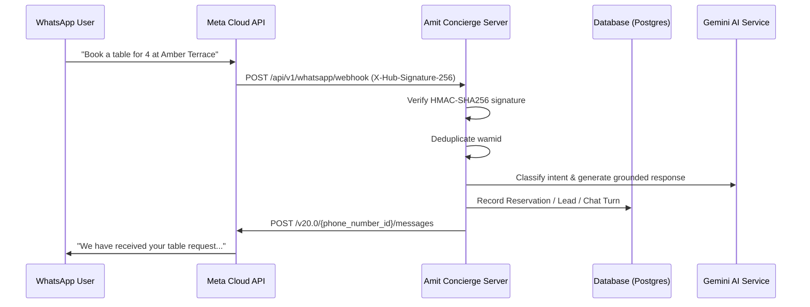

# Meta WhatsApp Business Cloud API Integration Guide
## Amit AI Concierge — Amit Hospitality (https://amithospitality.com/)

---

### 1. Overview
The Meta WhatsApp Cloud API integration enables guests of Amit Hospitality to converse with the AI Concierge, inquire about menus, reserve tables, submit private event inquiries, and escalate to human staff directly within WhatsApp.

Engineering features:
- **Webhook Challenge Verification:** Fully implements Meta's `hub.mode=subscribe` and `hub.challenge` handshake.
- **HMAC-SHA256 Payload Signature Verification:** Enforces security by checking `X-Hub-Signature-256` against `WHATSAPP_APP_SECRET`.
- **Message Deduplication:** Uses unique WhatsApp message IDs (`wamid`) to prevent double-processing on Meta delivery retries.
- **Bi-directional Integration:** Seamlessly maps incoming WhatsApp messages to customer profiles, reservations, leads, and human handover alerts.

---

### 2. Environment Configuration

Add the following variables to `.env`:

```env
WHATSAPP_TOKEN=EAA...your_permanent_meta_system_user_access_token
WHATSAPP_PHONE_NUMBER_ID=108923485712345
WHATSAPP_VERIFY_TOKEN=amit_concierge_whatsapp_verify_token_2026
WHATSAPP_APP_SECRET=your_meta_app_secret_from_app_dashboard
```

---

### 3. Meta Developer Portal Setup

1. **Create an App:** Log in to [Meta for Developers](https://developers.facebook.com/) and create a **Business** type application.
2. **Add WhatsApp Product:** Add the **WhatsApp** product to your app.
3. **Configure Webhook:**
   - Callback URL: `https://your-domain.com/api/v1/whatsapp/webhook`
   - Verify Token: Enter the value defined in `WHATSAPP_VERIFY_TOKEN`.
   - Webhook Fields: Subscribe to `messages`.
4. **App Secret:**
   - Under **App Settings > Basic**, reveal your **App Secret** and copy it into `WHATSAPP_APP_SECRET`.
5. **System User Token:**
   - In Meta Business Manager, create an Admin System User with `whatsapp_business_messaging` and `whatsapp_business_management` permissions to generate a permanent token.

---

### 4. Router & Endpoints

Defined in [`backend/app/routers/whatsapp.py`](file:///c:/Users/india/Desktop/amit%20hospitality/backend/app/routers/whatsapp.py):

| Method | Endpoint | Description |
|--------|----------|-------------|
| `GET` | `/api/v1/whatsapp/webhook` | Handles Meta verification challenge echo (`hub.challenge`). |
| `POST` | `/api/v1/whatsapp/webhook` | Receives inbound messages, verifies signature, executes concierge RAG. |
| `POST` | `/api/v1/whatsapp/test-connection` | Diagnostic endpoint checking Meta Graph API connectivity. |

---

### 5. Inbound Message Handling & Flow



---

### 6. Live Connectivity Verification

```bash
curl -X POST http://localhost:8000/api/v1/integrations/test/whatsapp \
  -H "Authorization: Bearer <ADMIN_JWT_TOKEN>"
```
Truthful response when configured:
```json
{
  "name": "Meta WhatsApp Business Cloud API",
  "status": "CONNECTED",
  "connected": true,
  "verified_at": "2026-11-08T18:45:00Z"
}
```
If unconfigured, returns `NOT CONFIGURED` with explicit remediation advice.
