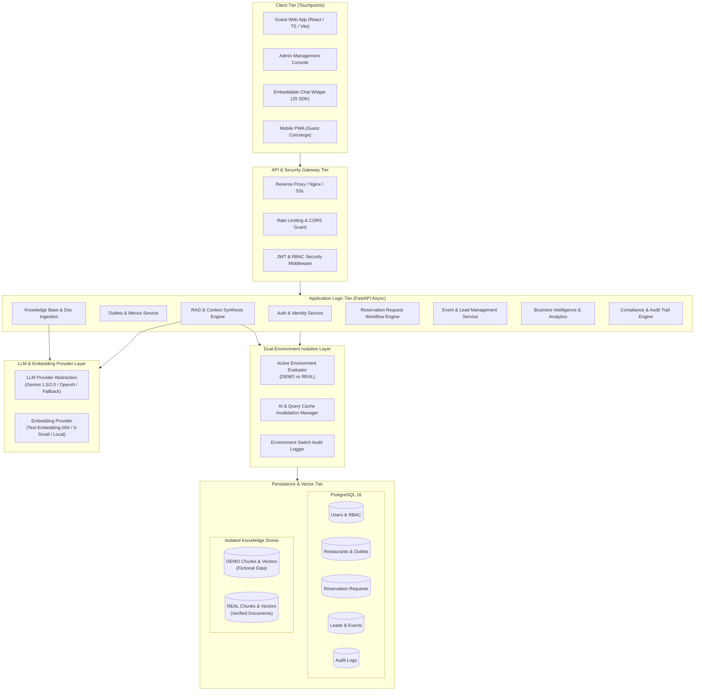
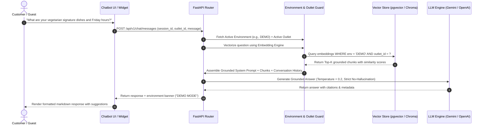

# AMIT AI CONCIERGE — SYSTEM ARCHITECTURE SPECIFICATION
## Enterprise AI Hospitality Management & Customer Concierge Platform
**Document Version:** 1.0.0  
**Target Organization:** Amit Hospitality  
**Architecture Classification:** Enterprise Production-Ready SaaS / On-Premise Solution  

---

## 1. Executive Summary & Vision

Amit AI Concierge is an enterprise-grade AI customer concierge and hospitality operations platform engineered for luxury dining and hospitality brands (inspired by Amit Hospitality's portfolio: upscale dining, craft cocktail lounges, and event destinations).

The system solves two fundamental challenges faced by luxury hospitality operators:
1. **Flawless 24/7 AI Guest Concierge:** Real-time conversational booking inquiries, dietary/menu consultations, private event lead capture, and policy guidance across web, mobile, and embeddable widgets with sub-second response times and zero hallucinations.
2. **Strict Dual-Environment Knowledge Isolation (DEMO vs. REAL Mode):** Complete separation between fictional demonstration data (sample menus, simulated reservations, demonstration pricing) and verified corporate assets (audited menus, verified wine lists, real outlet policies). Administrators can switch environments in real time with automated audit trails, cache purges, and absolute vector-space isolation.

---

## 2. High-Level System Architecture



---

## 3. Core Architectural Pillars

### 3.1. Zero-Leakage Knowledge Isolation (DEMO vs. REAL)

The platform enforces absolute isolation across database tables, vector embeddings, caching, and prompt context:

1. **Storage-Level Segregation:** Every knowledge item, document, chunk, menu item, FAQ, and policy record has a mandatory `environment` column (`DEMO` | `REAL`).
2. **Query-Level Enforcement:** The Active Environment is resolved per request. All SQL queries and vector similarity searches explicitly filter `WHERE environment = :active_env`. Cross-environment joins or retrieval are structurally prohibited.
3. **Prompt-Level Grounding:**
   - In **DEMO Mode**, the system prompt informs the AI that it is operating with sample, illustrative data, and appends a `[DEMO DATA - Sample Information Only]` disclaimer badge to all output.
   - In **REAL Mode**, the AI relies exclusively on verified documents. If a question cannot be answered from verified documents, it executes a strict fallback: *"I do not currently have verified information regarding this inquiry. Our guest relations team will be happy to assist you directly."*
4. **Instant Invalidation & Audit Logging:** When an administrator toggles the active environment:
   - An immutable audit log entry is persisted (`admin_id`, `from_env`, `to_env`, `timestamp`, `ip_address`).
   - In-memory response caches and semantic caches are purged instantly.
   - Active web sessions receive a notification of environment transition.

### 3.2. RAG (Retrieval-Augmented Generation) Pipeline



#### Document Processing Pipeline
1. **Ingestion:** Upload PDF, DOCX, XLSX, CSV, or TXT through Admin Knowledge Center.
2. **Extraction:**
   - PDFs processed with PyMuPDF (`fitz`) with structure preservation.
   - Word files processed with `python-docx`.
   - Menus & tabular spreadsheets processed with `openpyxl`/`pandas` preserving item-price relationships.
3. **Semantic Chunking:** Context-aware chunking (400-600 tokens with 15% overlap) tagging metadata: `outlet_id`, `category` (menu, policy, timing, private_dining), `environment` (DEMO/REAL), and `verified_status`.
4. **Vector Indexing:** Embeddings stored with `HNSW` index for cosine distance similarity.

---

## 4. Frontend Architecture

- **Framework:** React 18+ with TypeScript (strict type checking enabled).
- **Build Tool:** Vite for lightning-fast HMR and optimized production bundling.
- **Styling System:** Tailwind CSS with a luxury hospitality design system:
  - Base colors: Rich Obsidian (`#0B0C10`), Deep Charcoal (`#1F2833`), Warm Champagne Gold (`#D4AF37`, `#C5A059`), Soft Cream (`#F8F9FA`), and Warm Muted Slate (`#8E9AAF`).
  - Typography: Playfair Display / Cormorant Garamond for headings; Inter / Plus Jakarta Sans for high-legibility UI.
- **State Management:** Lightweight React Context + Zustand for chat state, session persistence, and environment indicators.
- **Motion & Transitions:** Framer Motion for smooth micro-interactions, drawer sliding, and conversational bubble reveals.
- **Icons:** Lucide React for consistent, crisp iconography.
- **Standalone Embeddable Widget:** Separate micro-bundle output (`concierge-widget.js`) embeddable via a single `<script>` tag on any external website.

---

## 5. Backend Architecture

- **Runtime & Framework:** Python 3.12+ with FastAPI (Async native, ASGI high throughput).
- **Data Validation & Serialization:** Pydantic v2 schemas for request validation and response filtering.
- **Database ORM:** SQLAlchemy 2.0 (Modern Declarative Mappings, Async-ready) + Alembic for migrations.
- **Dual-Database Compatibility:**
  - Production: PostgreSQL 16+ with `pgvector` extension.
  - Development / Fallback: SQLite with in-process vector cosine similarity computation (numpy) to ensure zero-friction local testing without external Docker/daemon requirements.
- **Security & Cryptography:** Passlib + Bcrypt for password hashing; PyJWT with RS256/HS256 for signed token authentication.
- **Documentation:** Automated OpenAPI 3.1 schemas at `/docs` (Swagger UI) and `/redoc`.

---

## 6. Role-Based Access Control (RBAC) Matrix

| Feature / Action | Super Admin | Admin | Manager | Staff | Guest |
| :--- | :---: | :---: | :---: | :---: | :---: |
| Switch DEMO / REAL Mode |  Yes |  Yes |  No |  No |  No |
| Manage Knowledge Base (Real Mode) |  Yes |  Yes | Read-Only |  No |  No |
| Manage Knowledge Base (Demo Mode) |  Yes |  Yes |  Yes | Read-Only |  No |
| Configure AI Models & Prompts |  Yes |  Yes |  No |  No |  No |
| Manage Outlets & Menus |  Yes |  Yes |  Yes | Read-Only |  No |
| Manage Reservation Requests |  Yes |  Yes |  Yes |  Yes | Submit Only |
| Manage Inquiries & Leads |  Yes |  Yes |  Yes |  Yes | Submit Only |
| View System Analytics & Reports |  Yes |  Yes | Outlet Only |  No |  No |
| View Security Audit Logs |  Yes |  Yes |  No |  No |  No |
| User & Staff Management |  Yes |  No |  No |  No |  No |
| Converse with Concierge |  Yes |  Yes |  Yes |  Yes |  Yes |

---

## 7. Directory Structure & Organization

```
amit-hospitality/
├── .env.example                     # Environment template
├── .gitignore                       # Git ignore policies
├── README.md                        # Master project guide
├── docker-compose.yml               # Container orchestration (Web, API, DB)
├── Dockerfile.backend               # Production container for FastAPI
├── Dockerfile.frontend              # Production container for Vite/Nginx
│
├── docs/                            # Architecture & Phase Documentation
│   ├── ARCHITECTURE.md              # System architecture (this document)
│   ├── DATABASE_SCHEMA.md           # Entity relationship & tables specification
│   ├── API_SPECIFICATION.md         # Complete REST API blueprint
│   └── DEVELOPMENT_ROADMAP.md       # Phase roadmap & verification checklist
│
├── backend/                         # FastAPI Application Core
│   ├── requirements.txt             # Python production dependencies
│   ├── pytest.ini                   # Pytest test configuration
│   ├── alembic.ini                  # Alembic database migrations
│   ├── app/
│   │   ├── __init__.py
│   │   ├── main.py                  # FastAPI initialization & middleware
│   │   ├── config.py                # Pydantic BaseSettings & env loading
│   │   ├── database.py              # Engine, SessionLocal, Base setup
│   │   ├── models/                  # SQLAlchemy 2.0 ORM Entities
│   │   │   ├── __init__.py
│   │   │   ├── user.py              # User, Role, Permission
│   │   │   ├── outlet.py            # Restaurant, Outlet, Category, MenuItem
│   │   │   ├── knowledge.py         # KnowledgeDoc, KnowledgeChunk, FAQ, Policy
│   │   │   ├── conversation.py      # Conversation, Message, Customer
│   │   │   ├── reservation.py       # ReservationRequest, Table
│   │   │   ├── lead.py              # Lead, EventInquiry
│   │   │   ├── audit.py             # AuditLog, EnvironmentSetting
│   │   │   └── ai_config.py         # AIModelConfig, PromptTemplate
│   │   ├── schemas/                 # Pydantic v2 Request/Response Models
│   │   │   ├── auth.py
│   │   │   ├── outlet.py
│   │   │   ├── knowledge.py
│   │   │   ├── chat.py
│   │   │   ├── reservation.py
│   │   │   ├── lead.py
│   │   │   └── analytics.py
│   │   ├── routers/                 # API Endpoint Controllers
│   │   │   ├── auth.py
│   │   │   ├── outlets.py
│   │   │   ├── knowledge.py
│   │   │   ├── chat.py
│   │   │   ├── reservations.py
│   │   │   ├── leads.py
│   │   │   ├── analytics.py
│   │   │   ├── audit.py
│   │   │   └── widget.py
│   │   ├── services/                # Business Logic Layer
│   │   │   ├── auth_service.py
│   │   │   ├── rag_service.py       # Semantic retrieval & LLM synthesis
│   │   │   ├── document_service.py  # PDF/DOCX/Excel extraction & chunking
│   │   │   ├── embedding_service.py # Vector embedding generation
│   │   │   ├── isolation_service.py # Active environment guard & invalidation
│   │   │   ├── reservation_service.py
│   │   │   └── analytics_service.py
│   │   └── utils/
│   │       ├── security.py          # Password hashing, JWT encode/decode
│   │       ├── seed_data.py         # DEMO environment seed data
│   │       └── text_cleaner.py
│   └── tests/                       # Automated Test Suite
│       ├── conftest.py              # Fixtures, test DB, authenticated clients
│       ├── test_auth.py             # Auth & RBAC enforcement tests
│       ├── test_isolation.py        # Crucial DEMO vs REAL isolation tests
│       ├── test_rag.py              # Chunking, retrieval & grounding tests
│       ├── test_reservations.py     # Booking flow tests
│       └── test_knowledge.py        # Ingestion & reindexing tests
│
└── frontend/                        # React + TypeScript + Vite UI
    ├── package.json
    ├── tsconfig.json
    ├── vite.config.ts
    ├── tailwind.config.js
    ├── index.html
    └── src/
        ├── main.tsx
        ├── App.tsx                  # Root router & layout selector
        ├── index.css                # Luxury design system styling
        ├── types/                   # TypeScript interfaces & types
        │   ├── auth.ts
        │   ├── chat.ts
        │   ├── outlet.ts
        │   ├── knowledge.ts
        │   └── reservation.ts
        ├── context/                 # Application Contexts
        │   ├── AuthContext.tsx      # Current user & permissions
        │   ├── EnvironmentContext.tsx # Active Environment (DEMO vs REAL)
        │   └── ChatContext.tsx      # Active conversation state
        ├── components/              # Reusable UI Components
        │   ├── common/              # Buttons, Badges, Modals, Tables, Loaders
        │   ├── customer/            # Customer Chatbot, Bubble, QuickPrompts
        │   ├── admin/               # Sidebar, Header, StatCards, Charts
        │   ├── reservation/         # Guest Reservation Form & Admin Drawer
        │   └── knowledge/           # Document Uploader, Chunk Inspector
        ├── pages/                   # Application Views
        │   ├── customer/
        │   │   └── ConciergePage.tsx # Public customer-facing luxury concierge
        │   ├── admin/
        │   │   ├── DashboardPage.tsx
        │   │   ├── KnowledgePage.tsx # DEMO / REAL Knowledge Center
        │   │   ├── OutletsPage.tsx   # Menus & Outlets
        │   │   ├── ReservationsPage.tsx
        │   │   ├── LeadsPage.tsx
        │   │   ├── AnalyticsPage.tsx
        │   │   └── SettingsPage.tsx  # Environment Toggle & AI Config
        │   └── auth/
        │       └── LoginPage.tsx
        └── widget/                  # Embeddable Widget Source
            └── embed.ts             # Standalone widget runtime loader
```

---

## 8. Verification & Acceptance Criteria
1. Architecture documents fully describe every technical subsystem, interface, and dependency.
2. Complete environment isolation guarantees are codified in database schemas and service contracts.
3. Every layer adheres to production software standards: typed code, explicit schemas, reproducible configurations.
