# AMIT AI CONCIERGE — DATABASE SCHEMA SPECIFICATION
## Comprehensive PostgreSQL & pgvector Schema Design
**Document Version:** 1.0.0  
**Storage Engines:** PostgreSQL 16+ (Production with `pgvector`) / SQLite 3.40+ (Local Testing Engine)

---

## 1. Entity-Relationship (ER) Diagram

```mermaid
erDiagram
    USERS ||--o{ AUDIT_LOGS : performs
    USERS ||--o{ KNOWLEDGE_DOCUMENTS : verifies
    USERS ||--o{ RESERVATION_REQUESTS : assigned_to
    USERS ||--o{ LEADS : assigned_to

    RESTAURANTS ||--o{ OUTLETS : contains
    OUTLETS ||--o{ MENU_CATEGORIES : organizes
    MENU_CATEGORIES ||--o{ MENU_ITEMS : contains
    OUTLETS ||--o{ POLICIES : defines
    OUTLETS ||--o{ FAQS : provides
    OUTLETS ||--o{ EVENTS : hosts
    OUTLETS ||--o{ PROMOTIONS : offers
    OUTLETS ||--o{ KNOWLEDGE_DOCUMENTS : owns
    OUTLETS ||--o{ CONVERSATIONS : contextualizes
    OUTLETS ||--o{ RESERVATION_REQUESTS : books
    OUTLETS ||--o{ LEADS : targets

    KNOWLEDGE_DOCUMENTS ||--o{ KNOWLEDGE_CHUNKS : splits_into

    CUSTOMERS ||--o{ CONVERSATIONS : engages_in
    CUSTOMERS ||--o{ RESERVATION_REQUESTS : places
    CUSTOMERS ||--o{ LEADS : submits

    CONVERSATIONS ||--o{ MESSAGES : records

    ENVIRONMENT_SETTINGS {
        int id PK
        string active_environment "DEMO | REAL"
        int updated_by_user_id FK
        datetime updated_at
        string switch_reason
    }

    USERS {
        int id PK
        string email UK
        string password_hash
        string full_name
        string role "SUPER_ADMIN | ADMIN | MANAGER | STAFF"
        boolean is_active
        datetime created_at
        datetime updated_at
    }

    RESTAURANTS {
        int id PK
        string name
        string slug UK
        string description
        string address
        string city
        string phone
        string email
        boolean is_active
        datetime created_at
    }

    OUTLETS {
        int id PK
        int restaurant_id FK
        string name
        string outlet_type "FINE_DINING | LOUNGE | BAR | CAFE | EVENT_SPACE"
        string cuisine_type
        time opening_time
        time closing_time
        string dress_code
        int seating_capacity
        boolean is_active
        datetime created_at
    }

    KNOWLEDGE_DOCUMENTS {
        int id PK
        string environment "DEMO | REAL"
        int outlet_id FK
        string title
        string file_name
        string file_type "PDF | DOCX | XLSX | CSV | TXT | MANUAL"
        string file_path
        int file_size_bytes
        string category "MENU | POLICY | TIMING | EVENT | GENERAL"
        string verification_status "VERIFIED | UNVERIFIED | PENDING"
        int verified_by_user_id FK
        datetime verified_at
        boolean is_active
        datetime created_at
        datetime updated_at
    }

    KNOWLEDGE_CHUNKS {
        int id PK
        int document_id FK
        string environment "DEMO | REAL"
        int outlet_id FK
        int chunk_index
        text content
        json metadata_json
        vector embedding "Dimension 768 / 1536"
        boolean is_active
        datetime created_at
    }

    MENU_CATEGORIES {
        int id PK
        int outlet_id FK
        string environment "DEMO | REAL"
        string name
        int display_order
        string description
        boolean is_active
        datetime created_at
    }

    MENU_ITEMS {
        int id PK
        int category_id FK
        int outlet_id FK
        string environment "DEMO | REAL"
        string name
        string description
        decimal price
        string currency
        string dietary_flags "VEG | NON_VEG | VEGAN | JAIN | GLUTEN_FREE"
        boolean is_available
        boolean is_signature
        int display_order
        datetime created_at
    }

    POLICIES {
        int id PK
        int outlet_id FK
        string environment "DEMO | REAL"
        string policy_type "CANCELLATION | DRESS_CODE | CHILDREN | VALET | SMOKING"
        string title
        text description
        boolean is_active
        datetime created_at
    }

    FAQS {
        int id PK
        int outlet_id FK
        string environment "DEMO | REAL"
        string category
        text question
        text answer
        boolean is_active
        datetime created_at
    }

    EVENTS {
        int id PK
        int outlet_id FK
        string environment "DEMO | REAL"
        string title
        text description
        datetime start_date
        datetime end_date
        decimal price
        boolean is_active
        datetime created_at
    }

    PROMOTIONS {
        int id PK
        int outlet_id FK
        string environment "DEMO | REAL"
        string title
        string code
        text discount_description
        date valid_from
        date valid_to
        boolean is_active
        datetime created_at
    }

    CUSTOMERS {
        int id PK
        string name
        string phone
        string email
        datetime created_at
        datetime last_seen_at
    }

    CONVERSATIONS {
        int id PK
        int customer_id FK
        string session_id UK
        int outlet_id FK
        string environment "DEMO | REAL"
        string status "ACTIVE | RESOLVED | HANDOVER_REQUESTED"
        string language "EN | HI"
        string channel "WEB | WIDGET | MOBILE"
        int rating
        text feedback
        datetime created_at
        datetime updated_at
    }

    MESSAGES {
        int id PK
        int conversation_id FK
        string sender_type "USER | ASSISTANT | SYSTEM | AGENT"
        text content
        json citations_json
        int tokens_used
        int response_latency_ms
        datetime created_at
    }

    RESERVATION_REQUESTS {
        int id PK
        string environment "DEMO | REAL"
        int customer_id FK
        int outlet_id FK
        string guest_name
        string guest_phone
        string guest_email
        int guest_count
        date reservation_date
        time reservation_time
        text special_requests
        string seating_preference "INDOOR | OUTDOOR | ROOFTOP | PRIVATE"
        string status "NEW | PENDING | UNDER_REVIEW | ACCEPTED | REJECTED | CANCELLED"
        text internal_notes
        int assigned_staff_id FK
        datetime created_at
        datetime updated_at
    }

    LEADS {
        int id PK
        string environment "DEMO | REAL"
        int customer_id FK
        int outlet_id FK
        string name
        string phone
        string email
        string enquiry_type "PRIVATE_DINING | CORPORATE_EVENT | WEDDING | BIRTHDAY | CATERING"
        int guest_count
        date target_date
        string budget_range
        string source "CHATBOT | DIRECT_WEB | WIDGET"
        string status "NEW | CONTACTED | QUALIFIED | PROPOSAL_SENT | WON | LOST"
        text notes
        int assigned_staff_id FK
        datetime created_at
        datetime updated_at
    }

    AUDIT_LOGS {
        int id PK
        int user_id FK
        string action "ENV_SWITCH | KNOWLEDGE_INGEST | KNOWLEDGE_DELETE | BOOKING_UPDATE"
        string entity_type
        int entity_id
        json previous_state_json
        json new_state_json
        string ip_address
        string user_agent
        datetime created_at
    }

    AI_CONFIGURATIONS {
        int id PK
        string environment "DEMO | REAL"
        string model_name
        float temperature
        int max_tokens
        text system_prompt
        int top_k_retrievals
        boolean is_active
        int updated_by_user_id FK
        datetime updated_at
    }
```



---

## 2. Table Specifications & Indexes

### 2.1. Environment Isolation Principle (DDL Level)
Every business table containing factual or transactional information possesses:
```sql
environment VARCHAR(10) NOT NULL DEFAULT 'DEMO' CHECK (environment IN ('DEMO', 'REAL'))
```
Composite indexes are applied to guarantee zero cross-contamination and sub-10ms lookup speeds:
- `CREATE INDEX idx_knowledge_chunks_env_outlet ON knowledge_chunks(environment, outlet_id, is_active);`
- `CREATE INDEX idx_menu_items_env_outlet ON menu_items(environment, outlet_id, is_available);`
- `CREATE INDEX idx_reservations_env_status ON reservation_requests(environment, status, reservation_date);`
- `CREATE INDEX idx_leads_env_status ON leads(environment, status);`

### 2.2. Vector Storage & Semantic Search Configuration
For PostgreSQL deployments with `pgvector`:
```sql
CREATE EXTENSION IF NOT EXISTS vector;

-- Vector column configured for 768 dimensions (Google text-embedding-004) or 1536 (OpenAI text-embedding-3-small)
ALTER TABLE knowledge_chunks ADD COLUMN embedding vector(768);

-- Cosine Distance Index using HNSW for ultra-fast approximate nearest neighbor retrieval
CREATE INDEX idx_chunks_embedding ON knowledge_chunks 
USING hnsw (embedding vector_cosine_ops)
WHERE environment = 'REAL' AND is_active = true;

CREATE INDEX idx_chunks_embedding_demo ON knowledge_chunks 
USING hnsw (embedding vector_cosine_ops)
WHERE environment = 'DEMO' AND is_active = true;
```

---

## 3. Database Migration & Seeding Strategy
- **Alembic:** All migrations versioned in `backend/alembic/versions/`.
- **Seed Scripts (`backend/app/utils/seed_data.py`):**
  - Seeds initial Super Admin (`admin@amithospitality.com`) with secure hashed password.
  - Seeds comprehensive, realistic **DEMO Environment** records:
    - 3 upscale outlets (e.g., *Saffron & Silk Fine Dining*, *The Velvet Lounge & Cocktail Bar*, *Amber Terrace Rooftop*).
    - 40+ handcrafted menu items with prices, descriptions, and allergens (all tagged `DEMO`).
    - Standard hospitality policies, operating hours, and upcoming promotional events.
  - Leaves the **REAL Environment** pristine, awaiting verified administrator uploads.
